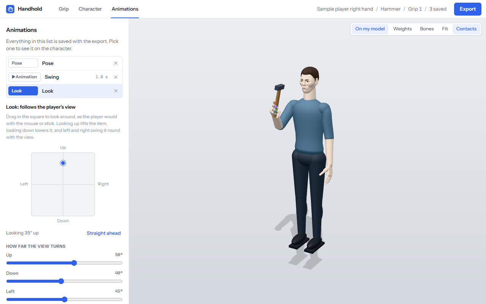
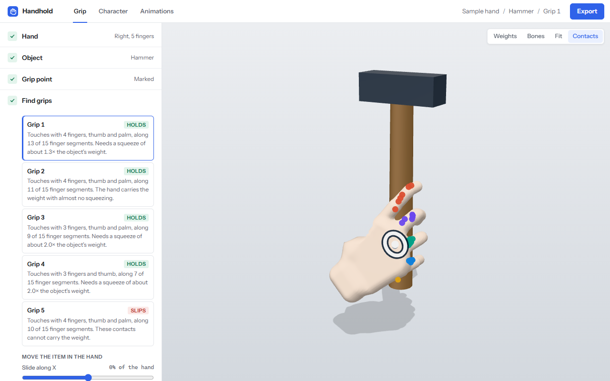

# Handhold

Make any character hold any prop. Handhold rigs the hand, finds grips that would physically hold, poses the arm, and exports the result to Unity, Godot and Blender with the animations that go with it.

It runs in your browser. Models are never uploaded.



**[Open Handhold](https://ozbrett.github.io/handhold/)**  ·  [Unity](docs/unity.md)  ·  [Godot](docs/godot.md)  ·  [Blender](docs/blender.md)  ·  [With Claude](docs/with-claude.md)  ·  [Command line](docs/command-line.md)

## What you get

- **A rigged hand.** Load a hand mesh with no bones and Handhold finds the fingers and places the joints. Load a whole character and it uses the bones the character already has.
- **Grips that hold.** Click where the hand should hold on. Handhold wraps the fingers onto the prop at many angles and checks each grip with friction and weight, so you can tell a grip that carries the prop from one that slips.
- **A posed arm.** Drag the prop to where it should be held and the hand, wrist and elbow follow, inside the range a human arm turns. One hand or both.
- **Poses, animations and looks.** Save still poses, ready-made animations (swing, fire, reload, use, idle, walk, run) and looks that make the arm follow the player's view.
- **One download per program.** Each holds the pose, a script that applies it to the character already in your project, and the posed model.



## Try it

Open **[ozbrett.github.io/handhold](https://ozbrett.github.io/handhold/)** and press **Use the sample player**, or drop your own hand or character file on the page. Add `?demo=hammer` to the address to see a grip straight away.

To run it on your own machine you need [Node.js](https://nodejs.org) 22.12 or newer:

```bash
git clone https://github.com/Ozbrett/handhold.git
```

```bash
cd handhold
```

```bash
npm ci
```

```bash
npm run dev
```

Then open the address it prints, usually http://localhost:5173/.

## How to use it

The **Grip** tab has six steps.

| Step | What you do |
|---|---|
| 1. Hand | Load a hand or a whole character (GLB, FBX, OBJ, STL or PLY), or use the sample. On a character, pick which hand |
| 2. Object | Load the prop, or pick a sample. Resize it if it came in the wrong units |
| 3. Grip point | Click the prop where the palm should go. Choose one hand or both |
| 4. Find grips | Pick one of the grips found. Each says whether it holds and how hard the hand has to squeeze |
| 5. Arm | Drag the prop to where it is held. Turn it with the sliders |
| 6. Export | Press **Unity**, **Godot** or **Blender** |

The **Character** tab shows the whole character and sets how far its joints may turn.

The **Animations** tab is where you save what the game will show. Everything in its list goes into the export under its name.

| Kind | What it is | In the game |
|---|---|---|
| Pose | A still position of the arm | The arm goes there and stays |
| Animation | A movement: swing, fire, reload, use, idle, walk, run | It plays once, or loops |
| Look | The arm's position for every direction the player can look in | Look up and the item goes up, look down and it goes down, and the same to the left and right |

On a pose or a look, the arrows in the view move either the item or the hand. Move the item and the hand holding it goes with it.

## In your engine

Each export works on the character that is already in your project, with its own bone names, whatever axes and scale it was imported with.

| Program | Download | Then | Guide |
|---|---|---|---|
| Unity | `.unitypackage` | Import it, select the character, **Tools > Handhold > Add grip to selected character** | [unity.md](docs/unity.md) |
| Godot 4.3+ | `.zip` | Unpack it, add a **HandholdGrip** node under the `Skeleton3D`, drag the pose onto it | [godot.md](docs/godot.md) |
| Blender | `.zip` | Select the armature and run the `.py`. Saved items arrive as Actions, poses in the Pose Library | [blender.md](docs/blender.md) |
| Unreal and others | `.glb` | Import it. It carries the pose, the prop and every animation | [pose-format.md](docs/pose-format.md) |

In Unity and Godot, show anything you saved by its name:

```csharp
var hold = GetComponent<HandholdGrip>();
hold.Show("Look");     // the arm follows the camera
hold.Show("Swing");    // plays once, then goes back to the look
hold.Show("Raised");   // a pose: stays until you show something else
```

```gdscript
$Skeleton3D/HandholdGrip.show_saved("Swing")
```

## With Claude, or from the command line

Handhold can be run with no window, which makes it something Claude Code can drive for you. Ask for "make my character hold the rifle with both hands, with fire and reload" and you get the files back, checked. [with-claude.md](docs/with-claude.md) has the setup and example requests.

The same thing by hand:

```bash
node scripts/handhold.mjs --hand character.glb --object rifle.glb --grip 0.3,0.5,0.5 --second 0.7,0.5,0.5 --size 5.5 --style weapon --clips use:Fire,second:Reload --look Aim
```

Every option is in [command-line.md](docs/command-line.md).

A grip is only as good as the wrist it is on. [Rig Doctor](docs/rig-doctor.md) checks a character's skin at the wrists (sleeves over the hand, cuffs weighted to the hand, a wrist that pinches when it turns) and fixes it, headless in Blender:

```bash
node scripts/rig-doctor.mjs fix character.blend --save character_fixed.blend --shots out/wrists
```

Every hold and every animation can be checked as a whole pose before it is used: joints in range, skin neither torn nor folded at the wrist, elbow and shoulder, nothing inside anything (hand, item, chest), elbows out from the body, the gun the right way up, and in an animation each hand staying on what it holds with no joint popping. Each check draws a contact sheet with every fault in red, and nothing is final until someone (or Claude) has looked at it and approved it:

```bash
node scripts/motion-check.mjs --motion reload/motion.json --out checked
node scripts/review.mjs approve checked reload --note "left hand stays on the magazine, elbows out"
```

A game hands over its own animations as a [motion file](docs/motion-check.md); `scripts/make-reload.mjs` builds a reload that keeps the shooting hand on the grip while the other hand draws the magazine and puts it back without letting go.

Before any of that, [Rig Check](docs/rig-check.md) says whether a model will animate at all without warping: its skeleton against
a default rig, every weight, and every joint turned as far as animation turns it while the skin is measured (thickness kept,
edges torn, skin dragged or left behind). It fixes what can be fixed in the weights, for people and creatures alike:

```bash
node scripts/rig-check.mjs check creature.fbx --report creature.rigcheck.json
```

## Limits

Handhold needs open hands with separate fingers: fists, mittens and fused fingers are not rigged. It is built around the palm, so it does not find precision pinches such as holding a pen. Arm posing needs a plain upper arm, forearm and hand chain.

The Unity and Blender exports are checked bone by bone against the app, in Unity 6000.6 and Blender 5.1. The Godot script follows the same logic but has not been run inside Godot yet.

[how-it-works.md](docs/how-it-works.md) has the full list, and explains how the rigging, the grip search and the physics check work.

## Contributing

[development.md](docs/development.md) covers the code layout, the tests and the headless engine checks. Bug reports with a model that shows the problem are the most useful kind.

## Credits

- [three.js](https://threejs.org) and [three-mesh-bvh](https://github.com/gkjohnson/three-mesh-bvh)
- The real hand used in the tests is the generic hand from [WebXR Input Profiles](https://github.com/immersive-web/webxr-input-profiles) (MIT). It is a development dependency and is not shipped with the site.
- Fonts: Bricolage Grotesque and Instrument Sans (SIL Open Font License)

## Licence

MIT. See [LICENSE](LICENSE).
